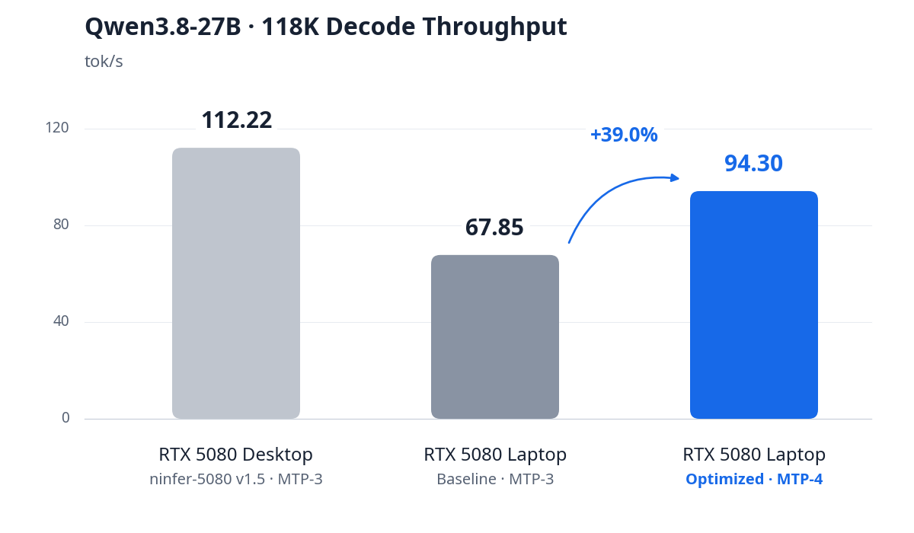

# NInfer RTX 5080 Laptop

[English](README.md) · [快速入门](docs/quickstart.md) · [文档索引](docs/README.md)

面向 **RTX 5080 Laptop 16 GB** 的 **Qwen3.8-27B CUDA 推理优化**。本项目基于 [toddballinger/ninfer-5080](https://github.com/toddballinger/ninfer-5080) v1.5 开发，其基础推理框架来自 [Neroued/ninfer](https://github.com/Neroued/ninfer)。

## 固定配置

笔记本对比使用**同一块 RTX 5080 Laptop 16 GB GPU（60 SM），功耗上限同为 175 W**，保留**原始 3.953 BPW 模型权重**、完整的 **131,072 token 上下文与 KV 容量**以及 **Q4 group64 KV**。CUDA Graph、主机映射 Embedding 和单请求执行配置保持一致。各负载使用相同语料和软件环境：32 GB DDR5、Windows 11、WSL2 Ubuntu 26.04、CUDA 13.4.92 和 NVIDIA 592.27 驱动。

优化沿用模型文件中的 Q3/Q4/Q5 整数编码与 FP16 缩放值，保持激活、KV 和持久状态格式，并按原有数值误差标准验证算子。

## 推理路径优化

### v1.5 MTP 检查点恢复越界修复

该修复建立了后续长上下文、MTP 和缓存复用实验的共同功能基线。[toddballinger/ninfer-5080 v1.5](https://github.com/toddballinger/ninfer-5080/releases/tag/qwen3.8-27b-rtx5080-128k-vision-v1.5) 在完整前缀命中、恢复响应检查点并重建多个 MTP 草稿时，`mtp_bridge_and_propose` 会将仅有一列的持久化 `prefill_hidden` 当作多列临时区使用。从第二个草稿开始，列切片越界并抛出 `slice range out of bounds`，导致该推理请求失败。

本项目从 GPU 临时显存工作区（workspace）中，为每一步新增草稿分配独立的 BF16 `[hidden,1]` 临时张量，再写回稳定的自回归 hidden state，保留持久化 prefill 尾状态。修复后，重复长提示能够通过完整前缀命中恢复并继续 MTP 推理；冷请求、精确检查点恢复和强制重算的回归对照保持 token 序列及结束状态一致。该修复覆盖 MTP-3、MTP-4，并由对比基线与优化版共同采用。实现见 [MTP 桥接修复](src/targets/qwen3_6/impl/runtime/mtp_impl.h)。

### MTP 权重共享与草稿窗口

模型文件提供 248,320 行完整输出头和 131,072 项草稿候选词表。载入时，程序逐行核对草稿权重与完整输出头中对应行的 Q4 编码和 FP16 缩放值；运行时通过索引直接读取完整输出头，保留原草稿词表及其顺序。GPU 仅额外保存 **512 KiB token ID 映射**，相比单独复制紧凑草稿输出头节省 **340 MiB 显存**。

草稿投影采用索引行 Tensor Core 内核，保留 BF16 logits、候选内 argmax 和原 token ID 映射。推荐配置将草稿窗口由 3 增至 4，使用 **MTP-4**：每轮生成 4 个草稿 token，通常以 T5 批量执行目标模型验证；MTP-3 对应 T4 验证。两种模式共享权重和运行时，并分别使用适合其验证宽度的内核。实现见[权重绑定](src/targets/qwen3_6_27b/impl/load/bindings.cpp)与[索引行投影](src/ops/linear/q4/q4_gather_rows.cu)。

### Q3 SwiGLU：双缓冲与单次多列计算

Q3 gate/up 投影通过两组共享内存缓冲区交替暂存权重，以 `cp.async` 重叠下一 K 分块的搬运与当前分块的计算。T5–T8 验证批量直接使用一个八列 MMA tile，在同一次权重遍历中处理全部有效 token 列，并由 epilogue 完成 SwiGLU 输出，减少拆分计算带来的重复权重读取。

共享内存中的打包编码行增加 16 字节填充，改善 bank 分布；T4 专用路径采用精确 PRMT 查表生成 BF16 编码对。大批量预填充的 INT3→INT8 打包则改用整数位操作，保留原激活量化与 MMA 路径。实现见 [Q3 小批量内核](src/ops/linear_swiglu/q3/q3_small_t_mma.cuh)与[整数打包](src/ops/common/int8_mma.cuh)。

### Q4 Linear：原生打包加载

MLP down、GDN 输出投影和完整词表输出头扩展了 T5–T8 的单次多列 MMA 路径，复用各 token 列所需的权重。共享内存编码行同样增加 16 字节填充，以减少行间 bank 冲突。

针对这三类普通 Linear 的 T5 路径，producer 先重排自身搬入的打包数据，再通过 Blackwell 原生 `ldmatrix … s8.s4` 加载有符号 Q4 编码，减少 fragment 重排与 warp shuffle。计算保留原整数值、分组 FP32 累加和既有缩放。实现见 [Q4 调度](src/ops/linear/q4/q4_dispatch.cpp)与[小批量 MMA 内核](src/ops/linear/q4/q4_small_t_mma.cuh)。

### Q5 与 GDN：补齐 Tensor Core 验证路径

注意力及 GDN 的 Q5 小批量投影新增 T4–T6 Tensor Core 路径：异步暂存低四位与高位编码，将有符号 Q5 整数精确表示为 BF16，完成 FP32 分组点积后再应用原 FP16 缩放值。该组织方式减少标量解码和累加开销，保留既有输出布局与卷积状态边界。

采用 Q4 value/z 权重的 GDN 层也从 SIMT 切换到 T4/T5 MMA，直接写入原有带步长的输出视图。QK 投影、物化 BF16 卷积边界、状态快照与恢复顺序保持一致；T4 和 T5 分别覆盖 MTP-3 与 MTP-4。实现见 [Q5 内核](src/ops/linear/q5/q5_small_t_mma.cuh)与 [GDN 投影集成](src/ops/gdn_input_proj/q4_q5/q4_q5_gdn_input_independent.cu)。

### 长上下文 Decode：压缩 KV 直接进入计算

Q4 Attention 将打包 K/V 的异步暂存扩展至 T5/T6，并用原生有符号 Q4 矩阵加载指令直接生成 K 的 INT8 MMA fragment，减少共享内存中的中间展开。V 在消费端解码为既有 BF16 PV tile，QK、softmax 与 PV 的计算精度保持一致。

面向单请求 T4/T5 长上下文路径，打包 K/V 搬运进一步由两次 8 字节拷贝改为一次 16 字节拷贝，保留原地址 swizzle、页映射和因果边界。这些改动同时服务 MTP-3、MTP-4，并继续使用完整的 Q4 group64 KV 容量。实现见 [Q4 Decode Attention](src/ops/kernel/gqa_attention_decode_q4.cuh)。

### Prefill：QK/PV 流水线与向量化解码

Q4 预填充 Attention 使用 **384 线程**调度：4 个 warp 负责 QK 与数据搬运，8 个 warp 消费概率和值矩阵。下一块概率和重缩放系数 alpha 先保存在生产者寄存器中，待当前 PV 完成后再发布到共享内存，使 QK 生产与 PV 消费重叠，保留既有 Q8 QK、FP16 概率/值与 FP32 累加路径。

大批量 MLP down 和 GDN 输出投影一次加载并解码 8 个 Q4 编码，以 128 位共享内存写入替代逐对写入；Q3 预填充同步采用精确的整数打包。这些优化作用于长提示和工具结果的预填充，两种 MTP 配置共用。实现见 [384 线程流水线](src/ops/kernel/gqa_attention_prefill_q4_pipeline384.cuh)与 [Q4 稠密投影](src/ops/linear/q4/q4_rowsplit_gemm_mma.cuh)。

### 精确分词缓存与运行时计时

分词器增加 **8 MiB 有界 LRU 缓存**，按普通文本段的完整原始字节复用 token 序列。特殊 token 扫描、BPE 边界和 token 顺序保持原有语义，使多轮 Agent 中重复的长文本段省去重复分词。该 CPU 缓存与 GPU KV 前缀复用共同减少续接准备工作。实现见[分词缓存](src/targets/qwen3_6/impl/frontend/tokenizer.cpp)。

共享运行时还统一了贪心解码的计数更新语义，并将强制 token 桥接和状态提交计入完整 MTP 轮次耗时。具体形状、指令、MTP 覆盖范围与算子结果见[优化说明](docs/optimization.md)。

## 性能提升



| 笔记本负载 | v1.5 基线 | 本项目 · MTP-4 | 提升 |
|---|---:|---:|---:|
| 118K 持续解码 | 67.845 tok/s | **94.295 tok/s** | **+39.0%** |
| 接近 128K 的中文推理、代码与 Agent 混合负载 | 60.2901 tok/s | **85.7366 tok/s** | **+42.2%** |

同一实现的 **MTP-3 混合吞吐为 81.4659 tok/s**；默认 MTP-4 在 100K 缓存 Agent 负载中的首 token 延迟 P95 为 **1.729 秒**（20 个阶段）。

图中的 **RTX 5080 Desktop** 参考值为 **112.215 tok/s**，引用 [toddballinger/ninfer-5080 v1.5](https://github.com/toddballinger/ninfer-5080/releases/tag/qwen3.8-27b-rtx5080-128k-vision-v1.5) 的发布数据。计量定义与数值验证见[性能测试方法](docs/benchmark-methodology.md)，逐项结果见[持续解码记录](bench/results/laptop-comparison.json)与[混合负载记录](bench/results/real-workload-summary.json)。

## 快速使用

按[快速入门](docs/quickstart.md)安装依赖、编译并下载模型，然后启动推荐配置：

```bash
python3 scripts/launch_ninfer.py --profile configs/laptop-128k-mtp4.json
```

OpenAI 兼容 API 地址为 `http://127.0.0.1:8080`。选择 [`configs/laptop-128k-mtp3.json`](configs/laptop-128k-mtp3.json) 即可使用 MTP-3。实现细节见[优化说明](docs/optimization.md)，API 参数见[服务文档](docs/serving.md)。

## 许可证

源码采用 **[Apache License 2.0](LICENSE)**，保留现有版权声明与第三方依赖许可证。[Qwen3.8-27B-RTX5080 模型](https://huggingface.co/ninfer-5080/Qwen3.8-27B-RTX5080)按其模型仓库许可证分发。
